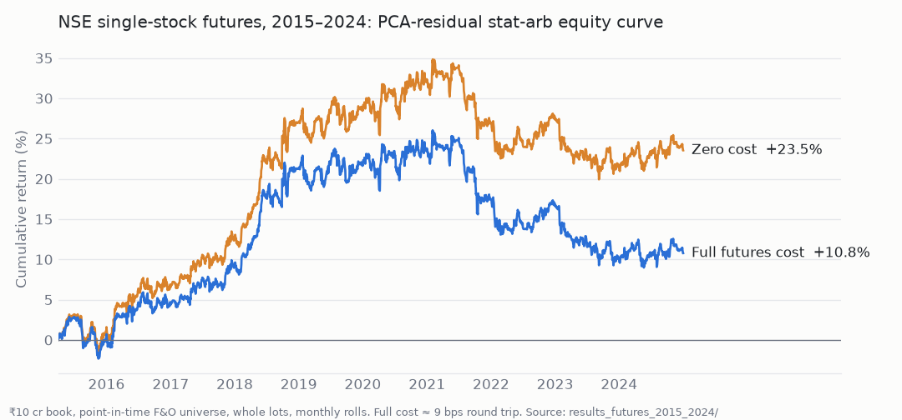
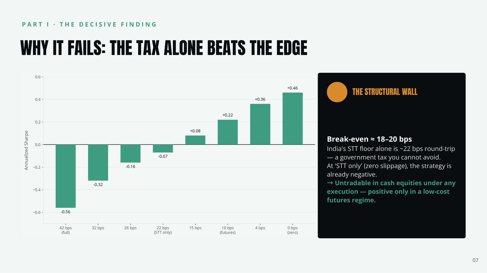
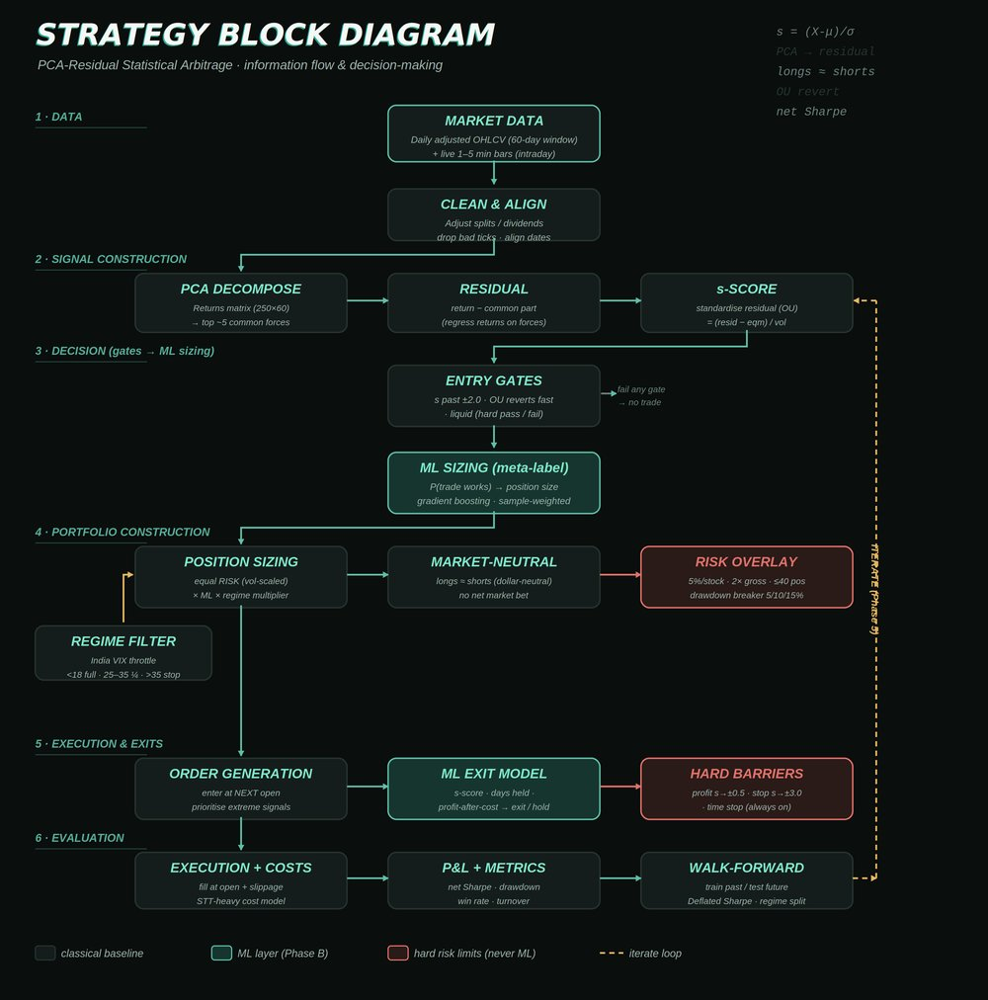

# SURP 2026: PCA-Residual Statistical Arbitrage on Indian Markets

**Does textbook stat-arb make money on NSE once you pay realistic costs?** I built the whole pipeline, ran it on ten
years of cash-equity and single-stock-futures data, and checked the answer hard enough to trust it.

**Code:** [kartikya2207/quant-stat-arb](https://github.com/kartikya2207/quant-stat-arb), the research repo with
the pipeline, tests and FINDINGS. This repo holds the documents: reports, slides and literature reviews.

Kartikya Saini (IEOR, IIT Bombay) · Summer Undergraduate Research Programme (SURP) 2026 · *Quantitative Research &
Trading Framework* project, Team A (Strategy Design) · Guide: Prof. Sandip Mondal (EE, IIT Bombay) · with Finedge

---

## Headline results

| NSE, daily, 2015–2024 | Zero cost | Realistic cost |
|---|---|---|
| **Cash equities** (435 names) | +32.9%, Sharpe +0.46 | **−32.9%, Sharpe −0.56** |
| **Single-stock futures** (292 names, point-in-time) | +23.5%, Sharpe +0.50 | **+10.8%, Sharpe +0.26 ± 0.32** |

*Futures, after realistic costs: positive but statistically indistinguishable from zero, concentrated in 2018.*

- **Cash equities are structurally untradable.** Break-even is ~18–20 bps round trip, and India's delivery STT
  alone is ~22 bps, so no execution quality fixes it.
- **Futures lower the cost floor, but not enough.** The edge dies between 5 and 8 bps of slippage per side, and
  the out-of-sample Fama–MacBeth test is insignificant on a point-in-time universe. Verdict: no statistically
  supported tradable edge.
- **The negative result is trustworthy.** The harness passes known-answer tests (+129.6% on a planted reversion
  edge, ~0 on a random walk), and equity rebuilt from the trade log matches to floating-point zero.

*Cash-equity cost sweep: Sharpe turns positive only below the STT floor.*

---

## Timeline

| When (2026) | Phase | What came out of it |
|---|---|---|
| late May – early June | **Phase 1: literature review** | Survey of classical strategies, pattern detection and market structure ([long review](literature/2026-05-24_Phase1_Literature_Review_long.pdf), [weekly update deck](presentations/2026-06-04_Weekly_Update_1_Phase1_LitReview.pptx)) |
| mid – late June | **Phase 2: strategy selection and design** | Structured and detailed reviews narrowing to PCA-residual stat-arb ([Phase 1 structured review](literature/2026-06-21_Phase1_Structured_Literature_Review.pdf), [Phase 2 detailed review](literature/2026-06-21_Phase2_Detailed_Literature_Review_PCA_StatArb.pdf)); design deck with the block diagram ([strategy presentation](presentations/2026-06-22_Phase2_Strategy_Presentation.pdf)) |
| late June – 1 July | **Cash-equity study** | Full backtest on NSE 2015–2024; result frozen; costs shown to exceed the edge |
| 1–2 July | **Midterm** | [Signed midterm report](reports/2026-07-01_SURP_Midterm_Report_signed.pdf), [midterm deck](presentations/2026-07-02_Midterm_Presentation.pptx) and [v2 deck](presentations/2026-07-02_Midterm_Presentation_v2.pptx) ([PDF](presentations/2026-07-02_Midterm_Presentation_v2.pdf)) |
| July – September | **Futures extension** | NSE bhavcopy pipeline, point-in-time F&O universe, rolls, lots, corporate actions; nine audits; [futures update deck](presentations/2026-09-10_Futures_Progress_Update.pptx), [futures-only deck](presentations/2026-09-10_Futures_Extension_Only.pptx) |
| 11 September | **Endterm** | [Endterm report](reports/2026-09-11_SURP_Endterm_Report.pdf) |

## What I did

- **Designed the strategy** from the literature: PCA on a rolling 60-day return window (5 factors), residual
  returns, an Ornstein–Uhlenbeck s-score, entries at |s| ≥ 2, triple-barrier exits, inverse-vol sizing, and a
  dollar-neutral book. Parameters stayed at literature defaults on purpose.
- **Built a look-ahead-safe backtester** (signal at *T* close → trade at *T+1* open) with a realistic Indian
  cost model: STT, exchange fees, stamp duty, GST, brokerage and slippage.
- **Ran the cash-equity study** on 435 NSE stocks over 2,466 trading days, with cost and turnover sweeps and
  out-of-sample Fama–MacBeth tests.
- **Built a futures data pipeline from scratch** using the free NSE bhavcopy archive: a point-in-time F&O
  universe (329 names seen, 292 kept), continuous contracts, monthly rolls, whole-lot sizing and 264
  corporate-action adjustments.
- **Audited my own results** and found real bugs: a corporate-action ledger bug booking fake P&L on 14 positions,
  a dividend-text parser missing NSE's `INTDV`/`SPDV` codes, and a missing trading session.

*The Phase 2 design. The ML layers (teal) were planned extensions; both studies use the classical baseline.*

## What I learnt

- **Costs are the strategy.** In cash equities a government tax alone beats the edge. In futures, slippage is 69%
  of the bill, so the sign of the headline rests on one assumption.
- **Survivorship bias can manufacture significance.** The cash study's out-of-sample significance mostly
  disappeared on a point-in-time universe. I corrected the earlier claim instead of quietly replacing it.
- **Accounting bugs hide in corporate actions.** Checking that realised position returns match signal returns
  on every held name-day caught them.
- **Don't tune to noise.** A non-monotonic factor-count sweep is a warning, not a winner to pick.
- **Under-powered is not the same as no edge.** A small cross-sectional IC exists, but the |s| ≥ 2 tail does
  not trade enough positions to prove it.

The detail behind all of this is in the FINDINGS files of
[quant-stat-arb](https://github.com/kartikya2207/quant-stat-arb).

---

## Files

| Path | What it is |
|---|---|
| `reports/2026-07-01_SURP_Midterm_Report_signed.pdf` | SURP midterm progress report, digitally signed by the guide (contact number and drive link removed) |
| `reports/2026-09-11_SURP_Endterm_Report.pdf` | SURP endterm report (contact number and drive link removed) |
| `literature/2026-05-24_Phase1_Literature_Review_long.pdf` | Phase 1 literature review, long form (19 pp.) |
| `literature/2026-06-21_Phase1_Structured_Literature_Review.pdf` | Phase 1 structured review of quantitative trading strategies (10 pp.) |
| `literature/2026-06-21_Phase2_Detailed_Literature_Review_PCA_StatArb.pdf` | Phase 2 detailed review of PCA-residual stat-arb for Indian equities (9 pp.) |
| `presentations/2026-06-04_Weekly_Update_1_Phase1_LitReview.pptx` | Weekly update 1: Phase 1 literature themes (19 slides) |
| `presentations/2026-06-22_Phase2_Strategy_Presentation.pdf` | Phase 2 strategy selection, detailed design and block diagram (15 slides) |
| `presentations/2026-07-02_Midterm_Presentation.pptx` | Midterm progress deck (14 slides) |
| `presentations/2026-07-02_Midterm_Presentation_v2.pptx` / `.pdf` | Restyled midterm deck; the PDF is an 11-slide export |
| `presentations/2026-09-10_Futures_Progress_Update.pptx` | Progress update: cash result plus the futures extension (5 slides) |
| `presentations/2026-09-10_Futures_Extension_Only.pptx` | Futures extension on its own (5 slides) |
| `docs/images/` | Figures used in this README and in quant-stat-arb |

## Related

- **Code and findings:** [kartikya2207/quant-stat-arb](https://github.com/kartikya2207/quant-stat-arb)
- **Primary reference:** M. Avellaneda and J.-H. Lee, "Statistical arbitrage in the U.S. equities market,"
  *Quantitative Finance* 10(7), 761–782, 2010. [doi:10.1080/14697680903124632](https://doi.org/10.1080/14697680903124632)
- The early version of the study lived on a fork of the team's TideTrader engine; that repo is private.
